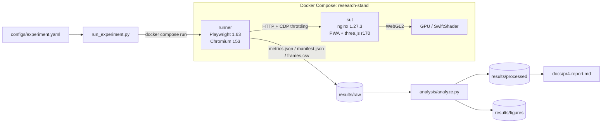

# Практическая работа № 3

## Критерии научности исследования и проектирование экспериментального стенда

**Темы ВКР:**

1. «Исследование методов ускорения рендеринга WebGL графики для формирования рекомендаций для разработчиков».
2. «Исследование производительности и пользовательского опыта прогрессивных веб-приложений (PWA) в условиях ограниченного доступа к сети».

Работа выполнена на едином объекте, который покрывает обе темы: прогрессивное веб-приложение
с WebGL-сценой. Тема 1 задаёт фактор метода рендеринга, тема 2 — фактор сетевого профиля и
режима кеширования service worker. Общая методологическая рамка позволяет не дублировать
стенд и получить выводы, пригодные для обеих тем.

---

## 1. Тема ВКР и краткая постановка задачи

Современное веб-приложение с трёхмерной графикой ограничено двумя независимыми ресурсами:
пропускной способностью графического конвейера и качеством канала связи. Первая тема ВКР
исследует, какие методы организации рендеринга (батчинг через `InstancedMesh`, уровни
детализации, сжатие геометрии) реально снижают стоимость кадра. Вторая тема исследует,
как прогрессивное веб-приложение (service worker, precache, app shell) меняет показатели
загрузки и доступности при медленной и нестабильной сети, и какой ценой достаётся выигрыш
при повторном визите.

Практическая проблема: рекомендации разработчикам часто формулируются по единичным замерам
или по данным вендоров, без указания окружения, числа повторений и разброса. В результате
«ускорение в 2 раза» на одном ноутбуке не воспроизводится на другом. Задача работы —
спроектировать стенд, который даёт воспроизводимые и статистически обоснованные ответы на
вопросы обеих тем, и заранее зафиксировать, какой результат будет считаться опровержением
гипотез.

**Объект исследования (SUT):** статическое PWA на three.js r170, раздаваемое nginx, с
WebGL2-сценой из 35 000 процедурно сгенерированных объектов и service worker, который
precache-ит оболочку приложения.

**Воздействие:** метод рендеринга (`baseline`, `instanced`, `lod`), профиль сети
(`fast`, `slow3g`) и режим кеширования (`no_sw_cold`, `sw_cold`, `sw_warm`,
`offline_sw`, `offline_control`).

**Измерения:** частота кадров и перцентили длительности кадра, число draw calls, LCP, TTFB,
время до первого кадра сцены, объём передачи, доля занятости main thread, успешность
офлайн-загрузки.

---

## 2. Подборка статей

### 2.1. Как формировалась подборка

Поиск выполнялся по запросам, объединяющим предметную область со словами `performance`,
`benchmark`, `evaluation`, `experimental setup`, `reproducibility`, в OpenAlex и по DOI
издательств. Для каждой найденной работы проверялись метаданные (год, издание, тип
публикации, наличие DOI) и аннотация; для открытых версий — полный текст. Отбор шёл по
трём критериям: близость к объекту (браузерный рендеринг или PWA), наличие собственного
эксперимента, пригодность описания методики для разбора.

Итоговая подборка: 9 статей; в 7 есть эксперимент с варьированием условий, ещё 2 —
эмпирические исследования пользователей и офлайн-поведения. Восемь работ опубликованы в
2023–2026 годах, шесть — в рецензируемых изданиях и трудах конференций (ACM, IEEE, ISPRS,
MDPI). Одна работа имеет полный replication package с зафиксированным окружением. Статьи [1]–[6] относятся к рендерингу, [7]–[9] — к PWA и веб-производительности;
на стыке тем работают [1], [2] и [9].

### 2.2. Сводная таблица анализа

Обозначения: `н/у` — в статье не указано; `Repro` — оценка воспроизводимости по шкале 0–3.

| № | Ссылка | Исследовательский вопрос / гипотеза | Объект (SUT) | Независимые переменные | Зависимые переменные | Контролируемые условия | Стенд | Методика | Статистическая обработка | Угрозы валидности | Артефакты | Repro |
|---|---|---|---|---|---|---|---|---|---|---|---|---|
| 1 | Han et al., WWW 2025 [1] | Можно ли ускорить существующие WebGL-приложения динамической трансляцией вызовов в WebGPU без переписывания кода | Три репрезентативных WebGL-бенчмарка | Графический API (WebGL / WebGPU через GL2GPU); устройство и ОС | Время кадра (end-to-end rendering), среднее сокращение 45,05 % | Визуальная согласованность результата; несколько устройств и ОС | Слой-транслятор GL2GPU, эмуляция состояний WebGL, оптимизации WebGPU | Протокол pre-registered, по-триальные записи, кампании на Mac mini M4, RTX 3070, Arc B390, Steam Deck (в replication package) | Среднее сокращение frame time по устройствам; разброс в статье н/у | Авторами н/у; из анализа — только 3 бенчмарка, разная зрелость бэкендов | Zenodo 10.5281/zenodo.22973847, GitHub `yudshj/GL2GPU-tint`, SHA-256 бандла, скрипты пересчёта таблиц | 3 |
| 2 | Li et al., IEEE Access 2020 [2] | Снизит ли разделение данных модели и анимации с on-demand загрузкой задержку мобильного Web 3D | WebGL-библиотеки для мобильного 3D; три модели с анимацией | Метод загрузки (централизованный / on-demand), гранулярность анимации, число треков, замедление CPU, профиль сети | Задержка загрузки и рендеринга, мс; средняя экономия 24,72 % | Chrome 79, Windows 10, i7-8750H, GTX 1060, троттлинг Chrome DevTools, фиксированные модели | Собственный прототип + Chrome DevTools | Повторения и прогрев н/у; таблицы по одному замеру на условие | Средние значения, без интервалов и тестов | Авторами н/у; из анализа — десктопный браузер вместо мобильного, один прогон | н/у | 1 |
| 3 | Hamzaturrazak et al., SIET 2023 [3] | Сравнить производительность raw WebGL и GLSL-шейдеров при рендеринге 3D в веб-AR | AR.js-приложение с low-, medium- и high-poly моделями | Подход к рендерингу (WebGL / GLSL), сложность модели | Производительность рендеринга (единицы в аннотации не уточнены) | н/у | Браузер + AR.js | н/у | н/у | Авторами н/у; из анализа — нет данных о железе, браузере и повторениях | н/у | 1 |
| 4 | Хвалина и др., GraphiCon 2024 [4] | Какие методы оптимизации 3D-сцен в WebGL дают наибольший эффект | Заранее подготовленные 3D-сцены | Instancing, LOD, PBR, batching и др. | Время загрузки страницы и общая эффективность приложения | н/у | Собственные сцены, эксперименты + метод анализа иерархий (AHP) | н/у | AHP-веса приоритетов; статистические тесты н/у | Авторами н/у; из анализа — смешение подготовки ассетов и рендеринга, нет разброса | н/у | 1 |
| 5 | Usta, ISPRS 2024 [5] | Насколько WebGPU быстрее WebGL при рендеринге 3D-моделей города | Чистые реализации WebGL и WebGPU без three.js/babylon.js | API (WebGL / WebGPU), размер датасета (200–3000 объектов) | Runtime в мс; объём данных, рендерящихся при ≥60 FPS | Одинаковые датасеты, отказ от сторонних библиотек и пост-обработки | Собственные реализации на чистом API, датасеты city models | Повторения и прогрев н/у | Только описательные значения: WebGPU в 2,5–3 раза быстрее | Авторы признают зависимость от типа приложения, железа и используемых функций | н/у | 1 |
| 6 | Jo, Choi, Applied Sciences 2026 [6] | Обеспечивает ли система real-time рендеринг 3D point cloud при 500 и 5000 узлах в guided/free режимах | Веб-система визуализации поведенческих эмбеддингов | Нагрузка (N = 500 / 5000), режим (guided / free) | Показатели рендеринга в реальном времени, интерактивность, полнота логов сессии | Condition-locked настройки (load × guidance), синтетический суррогатный датасет, логирование взаимодействий | Собственная система, синтетические данные | н/у (в аннотации) | н/у | Авторами н/у; из анализа — синтетические данные вместо реальных эмбеддингов | Синтетический датасет заявлен как средство воспроизводимости; ссылка в доступном тексте н/у | 2 |
| 7 | Othman et al., JOCCH 2024 [7] | Как пользователи оценивают UX культурного PWA по шести измерениям UEQ | PWA культурного наследия Саравака (SCHPWA) | Экспериментальных факторов нет; демография участников | Шесть шкал UEQ: attractiveness, perspicuity, efficiency, dependability, stimulation, novelty; квадранты IPA | UCD в Agile, 239 участников (184 женщины, 55 мужчин) | Онлайн-опрос UEQ + Importance-Performance Analysis | n = 239; детали отбора не в аннотации | Описательные шкалы UEQ, IPA-квадранты; тесты значимости н/у | Авторами н/у; из анализа — удобная выборка, один регион, самоотчёт | н/у | 1 |
| 8 | Muppaneni, IJETCSIT 2024 [8] | Как измерить качество офлайн-UX PWA и сравнить приложения из разных доменов | Несколько PWA из разных предметных областей | Приложение и его офлайн-стратегии | Готовность к офлайну, паттерны fallback, непрерывность задачи; набор метрик | н/у | Смешанный метод: эвристическая оценка, тестирование кеширования и синхронизации, сравнительный анализ | н/у | н/у | Авторами н/у; из анализа — нет количественных повторений и единиц измерения | н/у | 1 |
| 9 | Талиев, Анищенко, 2025 [9] | Насколько lazy loading, WebP, кеширование и минификация улучшают метрики PWA | Twitter Lite, Starbucks PWA, AliExpress (локальные копии) | Состояние «до» и «после» оптимизаций | FCP, TTI, объём трафика, общее время загрузки | Три приложения разного профиля, Lighthouse в Chrome DevTools, WebPageTest; упоминается сеть 3G | Lighthouse, WebPageTest | Один замер до и один после; повторения н/у | Проценты изменений; интервалы и тесты н/у | Авторами н/у; из анализа — сравнение «до/после» без контроля, изменены сразу четыре фактора | н/у | 1 |

### 2.3. Паспорта статей

**1. GL2GPU (WWW 2025, ACM).** Работа ближе всего к первой теме: авторы не переписывают
приложение, а транслируют вызовы WebGL в WebGPU во время исполнения. Экспериментальная
часть описана в статье кратко (три бенчмарка, среднее сокращение времени кадра 45,05 %), но
replication package снимает почти все вопросы к методике: в нём есть `protocol.json` с
заранее зарегистрированным протоколом, `run.mjs` и `recompute.mjs`, по-триальные записи
четырёх кампаний (Mac mini M4, RTX 3070, Arc B390, Steam Deck), хеши SHA-256 для
зафиксированного бандла и скрипты, пересчитывающие каждую таблицу статьи из сырых данных.
Это редкий пример того, как «артефакт» действительно обеспечивает проверяемость, а не
формально приложен к публикации. Ограничение: перенос на произвольное приложение не
доказан, а зрелость WebGPU-бэкендов на момент измерения различалась.

**2. Li et al. (IEEE Access 2020).** Метод: разделить топологию и анимацию, грузить
анимационные последовательности по требованию и асинхронно. Измеряется задержка загрузки и
рендеринга в миллисекундах, условия задаются троттлингом Chrome DevTools (сеть и CPU).
Среда зафиксирована подробно: Chrome 79, Windows 10, i7-8750H, GTX 1060. Главный недостаток
для нашей задачи: измерения выполнены на десктопном браузере, а выводы формулируются для
мобильного Web 3D; повторения и разброс не описаны, поэтому 24,72 % — точечная оценка без
интервала.

**3. Hamzaturrazak et al. (SIET 2023, ACM).** Сравнение raw WebGL и GLSL-шейдеров на
AR.js-приложении. Ценный качественный вывод: на high-poly моделях raw WebGL деградирует, а
шейдерный путь держится на уровне нативного рендеринга. Однако в аннотации нет ни методики
повторений, ни характеристик стенда; по статье нельзя восстановить, сколько прогонов
сделано и как считалась производительность. Оценка воспроизводимости — 1.

**4. Хвалина и др. (GraphiCon 2024).** Единственная в подборке работа, где систематически
сопоставлены именно те методы, которые мы проверяем: instancing, LOD, PBR, batching. Авторы
применяют AHP для приоритизации методов и измеряют время загрузки страницы и «общую
эффективность». Сильная сторона — широта охвата и российская площадка (РИНЦ). Слабая —
смешение оптимизации ассетов (подготовка моделей и текстур) и оптимизации рендеринга, из-за
чего нельзя понять, какая часть эффекта относится к draw call, а какая — к размеру файла.

**5. Usta (ISPRS 2024).** Чистое сравнение API: одинаковые модели города, реализации без
three.js и пост-обработки, чтобы исключить оптимизации библиотек. Результат: WebGPU в
2,5–3 раза быстрее WebGL, в том числе на минимальной сцене из 8 вершин. Это важный
методический ход — контроль «по библиотеке» — но статья не сообщает ни число повторений,
ни разброс, ни характеристики машины, поэтому её числа нельзя напрямую сравнивать с нашими.

**6. Jo, Choi (Applied Sciences 2026).** Ближайшая по духу к нашей конструкции: нагрузка
задаётся числом узлов (500 и 5000), режим работы фиксируется, используется синтетический
суррогатный датасет, а взаимодействия логируются. Это пример корректной работы с
воспроизводимостью входных данных, хотя авторы и признают, что валидация на реальных
эмбеддингах остаётся в будущем.

**7. Othman et al. (JOCCH 2024, ACM).** Пользовательское исследование PWA: 239 участников,
валидированный опросник UEQ и матрица IPA. Метрики операционализированы через шкалы
опросника, что снимает проблему «производительность без определения». Ограничения —
самоотчёт, удобная выборка и один культурный контекст; к тому же UX здесь не связывается с
сетевыми условиями, что для нашей второй темы принципиально.

**8. Muppaneni (IJETCSIT 2024).** Единственная работа, которая прямо ставит вопрос об
офлайн-UX и предлагает набор метрик. Метод смешанный: эвристическая оценка, тестирование
кеширования и синхронизации, сравнение приложений. Слабости типичны для обзорно-прикладных
работ: нет воспроизводимой процедуры измерения, нет повторений, приложения не
зафиксированы в конкретных версиях.

**9. Талиев, Анищенко (2025).** Практический отчёт о внедрении четырёх оптимизаций в три
известных PWA. Числа выглядят правдоподобно и согласуются с отраслевыми отчётами: FCP
3,2 → 1,8 с у Twitter Lite, TTI 5,6 → 3,1 с, трафик 1,8 → 0,9 МБ. Но методологически это
сравнение «до/после» без контроля: одновременно меняются lazy loading, формат изображений,
кеширование и минификация, поэтому вклад каждого фактора не идентифицируется, а один замер
не позволяет отделить эффект от шума.

---

## 3. Синтез: практика экспериментов в предметной области

**Что принято измерять.** В работах по браузерному рендерингу устойчивый набор метрик
невелик: время кадра или FPS ([1], [5]), задержка загрузки/рендеринга в миллисекундах ([2]),
число draw calls и объём геометрии ([4]), реже — энергопотребление и загрузка GPU. В
работах по PWA доминируют метрики загрузки и трафика: FCP, TTI, LCP, объём переданных
данных ([9]), доступность офлайн и непрерывность задачи ([8]), а также субъективные шкалы
UX ([7]). Наша подборка показывает разрыв: рендеринг измеряют в миллисекундах кадра, а UX
PWA — либо в миллисекундах загрузки, либо в баллах опросника; совместить эти два слоя в
одном стенде почти никто не пытается.

**Как измеряют.** Типовая конструкция — один компьютер, один браузер, несколько
конфигураций и один прогон на конфигурацию ([2], [5], [9]). Троттлинг сети и CPU выполняют
через Chrome DevTools ([2]) или специализированные сервисы вроде WebPageTest ([9]).
Повторения, прогрев и рандомизация порядка встречаются редко; статистика ограничивается
средними и процентами. Единственная работа с полноценной методологией — [1]: заранее
зарегистрированный протокол, несколько аппаратных платформ, по-триальные записи и
пересчёт таблиц из сырых данных. Именно она задаёт планку, к которой мы стремимся.

**Типичные ошибки.**

1. **Один прогон на конфигурацию.** [2], [5], [9] сообщают точечные оценки без разброса.
   На нашем стенде коэффициент вариации FPS между прогонами одной конфигурации составил
   5,7 %, а минимальный обнаруживаемый эффект — около 16 %; значит, разница в 7 %, о
   которой иногда пишут в отчётах, на таком стенде неотличима от шума.
2. **Смешение факторов.** [9] меняет четыре оптимизации одновременно, [4] смешивает
   подготовку ассетов и рендеринг. В результате нельзя сказать, какой метод дал эффект.
3. **Неописанное окружение.** [3], [4], [8] не фиксируют версии браузера, железа и
   параметров сцены; воспроизвести такие измерения нельзя даже при наличии кода.
4. **Метрика без операционального определения.** «Производительность» и «эффективность»
   в [3] и [4] не разложены на измеримые величины с единицами.
5. **Игнорирование прогрева и порядка.** Ни одна работа, кроме [1], не упоминает warm-up
   и рандомизацию; при этом дрейф метрик во времени мы наблюдали и в собственной кампании.
6. **Отсутствие артефактов.** У 8 из 9 работ нет доступного кода или данных, поэтому
   оценка воспроизводимости у большинства — 1 балл.

**У кого методика лучше и почему.** Лучшая — [1]: протокол зарегистрирован до эксперимента,
сырые записи сохранены по Trial, окружение зафиксировано хешами, а таблицы статьи
пересчитываются скриптом. Второе место — [6] за condition-locked настройки и синтетический
датасет, который снимает зависимость от закрытых данных. Третье — [7] за валидированный
инструмент измерения UX и достаточный объём выборки. Общий вывод для нашей ВКР: нужно
соединить инженерную фиксацию окружения из [1] с дисциплиной плана (факторы, повторения,
рандомизация) и с операциональными метриками обеих предметных областей.

---

## 4. Критерии научности для нашей ВКР

### 4.1. Исследовательские вопросы и гипотезы

**RQ1 (тема 1).** Даёт ли замена отдельных мешей на `InstancedMesh`, а также переход на
уровни детализации, статистически значимый прирост частоты кадров при неизменной сцене,
разрешении и графическом бэкенде?

- **H0₁:** медиана FPS для `instanced` не отличается от медианы FPS для `baseline`.
- **H1₁:** медиана FPS для `instanced` выше, чем для `baseline` (направленный эффект,
  ожидаемый порядок — в 2–4 раза, по данным [1], [4], [5]).
- **H0₂:** медиана FPS для `lod` не отличается от `baseline`.
- **H1₂:** медиана FPS для `lod` выше, чем для `baseline`; ожидаемый эффект положительный,
  но меньше, чем у `instanced`, поскольку LOD снижает число треугольников, а не число
  draw calls.

**RQ2 (тема 2).** Сокращает ли активный service worker время загрузки и объём передачи при
повторном визите в сети 3G, и какова цена первого визита?

- **H0₃:** медиана `load_ms` и `first_frame_ms` для `sw_warm` не отличается от
  `no_sw_cold` в профиле `slow3g`.
- **H1₃:** медиана `load_ms` и `first_frame_ms` для `sw_warm` ниже, чем для `no_sw_cold`,
  а `transfer_bytes` равно нулю (ожидаемый порядок — сокращение на 40–80 %, по данным [9]).
- **H0₄:** первый визит с service worker (`sw_cold`) не медленнее, чем без него.
- **H1₄:** `sw_cold` медленнее `no_sw_cold`, поскольку установка service worker и precache
  добавляют работу.

**RQ3 (контроль).** Доступно ли приложение офлайн только при активном service worker?

- **H0₅:** доля успешных офлайн-загрузок не зависит от наличия service worker.
- **H1₅:** при `sw` доля успешных загрузок близка к 100 %, без `sw` — к 0 %.

### 4.2. Переменные

| Тип | Переменная | Уровни / единицы | Как измеряется |
|---|---|---|---|
| Независимая | `render` | `baseline`, `instanced`, `lod`, `none` | параметр URL, реализация в `scene.js` |
| Независимая | `transport` | `fast`, `slow3g` (300 мс RTT, 1,6/0,75 Мбит/с, CPU ×4) | CDP `Network.emulateNetworkConditions`, `Emulation.setCPUThrottlingRate` |
| Независимая | `mode` | `no_sw_cold`, `sw_cold`, `sw_warm`, `offline_sw`, `offline_control` | сценарий раннера, регистрация `sw.js` |
| Зависимая | `fps_mean` | кадр/с, среднее за окно 6000 мс | `requestAnimationFrame` + `performance.now()` |
| Зависимая | `frame_p95_ms` | мс, 95-й перцентиль длительности кадра | там же |
| Зависимая | `lcp_ms` | мс | `PerformanceObserver('largest-contentful-paint')` |
| Зависимая | `first_frame_ms` | мс от начала навигации до первого кадра сцены | метка в rAF после инициализации сцены |
| Зависимая | `load_ms` | мс | Navigation Timing, `loadEventEnd` |
| Зависимая | `transfer_bytes` | байты | `PerformanceResourceTiming.transferSize` |
| Зависимая | `offline_ok` | булево | успешность навигации при `context.setOffline(true)` |
| Зависимая | `main_thread_busy_pct` | % времени | CDP `Performance.getMetrics`, `TaskDuration` |
| Контролируемая | Сцена | 35 000 объектов, canvas 960×540, viewport 1280×720 | конфиг и код |
| Контролируемая | Сид сцены | `seed + номер повторения` | `configs/experiment.yaml` |
| Контролируемая | Браузер | Chromium 153.0.8010.12, headless, фиксированные флаги | образ раннера и манифест |
| Контролируемая | Ресурсы | CPU-бэкенд, отсутствие конкурирующих процессов | протокол прогона |

### 4.3. Критерий успеха

Практически значимым считаем изменение, которое превышает шум стенда и заметно
пользователю:

- для рендеринга — рост медианы FPS не менее чем на 20 % относительно `baseline` **и**
  снижение `frame_p95_ms` не менее чем на 20 %. Порог 20 % выбран потому, что A/A-тест дал
  минимальный обнаруживаемый эффект около 16 % при α = 0,05 и мощности 0,8; всё, что ниже,
  неотличимо от шума. Ориентир из литературы — кратный рост (2,5–3 раза в [5]), поэтому
  20 % — консервативная нижняя граница;
- для PWA — сокращение медианы `load_ms` и `first_frame_ms` не менее чем на 30 % и
  сокращение `transfer_bytes` не менее чем на 50 % при переходе к `sw_warm` в профиле
  `slow3g`; ориентир — 43–62 % в [9];
- для офлайн-доступности — 100 % успешных загрузок при `sw` и 0 % без него; при 10 прогонах
  это отделяет гипотезу от шума с высокой уверенностью (точный критерий Фишера даёт
  p < 0,001).

### 4.4. Критерии научности и их выполнение в работе

**Объективность и измеримость.** Каждая метрика определена операционально: указан
источник (`performance.now`, Navigation Timing, `PerformanceObserver`, CDP), единица
измерения и окно усреднения. Метрика «производительность» не используется; вместо неё —
`fps_mean`, `frame_p95_ms`, `lcp_ms`, `load_ms`, `first_frame_ms`.

**Контроль переменных.** Варьируется ровно один фактор при фиксированных остальных:
в блоке A меняется только `render`, в блоке B — только `transport` и `mode` при
`render = baseline`. Фиксируются сцена (число объектов, сид), разрешение, браузер, флаги,
состояние кеша (новый browser context на каждый прогон). Исказить результат могут:
тепловой дрейф, фоновые процессы, политика энергосбережения, различие GPU, а также
непреднамеренное кеширование между прогонами.

**Повторяемость (repeatability).** Один и тот же стенд, запущенный повторно, должен давать
согласованные выводы. Проверка: 10 повторений на конфигурацию, A/A-тест, повторная
кампания на другом сиде (`configs/repeat.yaml`). Критерий: направление эффекта совпадает,
различие медиан в A/A незначимо.

**Воспроизводимость (reproducibility).** Другой человек на нашем артефакте получает те же
результаты. Обеспечивается контейнерами с фиксированными версиями, lock-файлами
зависимостей, конфигом в репозитории, сидом, манифестом прогона и одной командой запуска.

**Реплицируемость (replicability).** Другой человек по нашему описанию строит свою
реализацию и получает согласующийся результат. Обеспечивается тем, что в отчёте описаны
не только команды, но и алгоритм сцены, правило LOD, схема кеширования и способ расчёта
метрик; расхождение допускается в пределах, заданных в разделе 5.3.

**Внутренняя валидность.** Эффект должен вызываться фактором, а не посторонней причиной.
Меры: рандомизация порядка, новый контекст браузера на прогон, одинаковый сид внутри
повторения для всех конфигураций, проверка отсутствия значимого дрейфа, контроль занятости
main thread, калибровка на пустой сцене.

**Внешняя валидность.** Результат должен переноситься на реальные условия. Ограничения:
headless-браузер, один GPU (Intel UHD), синтетическая сцена, эмуляция 3G без потерь пакетов.
Меры: отдельный контрольный прогон на программном растеризаторе, явная фиксация
характеристик машины, обсуждение границ переноса в отчёте.

**Конструктная валидность.** Метрика должна измерять то, что мы имеем в виду. Для
рендеринга FPS и p95 кадра действительно отражают плавность; для PWA LCP на canvas-сцене
измеряет не готовность сцены, а первый крупный элемент интерфейса, поэтому дополнительно
вводится `first_frame_ms` — время до первого кадра WebGL. Это признаётся ограничением, а не
маскируется.

**Статистическая валидность.** Выводы подкрепляются корректной статистикой: единица
наблюдения — прогон, а не кадр; используются медиана, IQR, bootstrap-интервалы,
тест Манна–Уитни, поправка Холма на множественные сравнения и размер эффекта δ Клиффа.
Нормальность не предполагается.

**Фальсифицируемость.** Заранее определено, какой результат опровергнет гипотезу:

- H1₁ опровергается, если медиана FPS `instanced` не превышает `baseline` более чем на
  20 % или различие незначимо после поправки Холма;
- H1₂ опровергается, если `lod` не даёт роста FPS относительно `baseline` (именно это и
  произошло в основном эксперименте — гипотеза отклонена);
- H1₃ опровергается, если сокращение `load_ms`/`first_frame_ms` меньше 30 % или
  `transfer_bytes` не равно нулю;
- H1₅ опровергается, если доля успешных офлайн-загрузок без service worker больше нуля.

---

## 5. Как результаты проверят другие разработчики

### 5.1. Уровни фиксации

| Что зафиксировать | Как | Инструменты |
|---|---|---|
| Код | версия и тег | Git, GitHub/GitLab Releases; в манифесте — `git_commit`, `git_dirty` |
| Зависимости | точные версии | `runner/requirements.txt`, `analysis/requirements.txt`, версия three.js в `sut/public/vendor` |
| Окружение | образы с фиксированными тегами | `nginx:1.27.3-alpine`, `mcr.microsoft.com/playwright/python:v1.63.0-noble`, `python:3.12.10-slim`; Docker Compose |
| Данные | синтетическая сцена, сид, версия кода сцены | `seed` в конфиге, `objects = 35000`, хеш конфига |
| Конфигурация | параметры вне кода | `configs/experiment.yaml` (YAML), хеш конфига в манифесте |
| Случайность | сид сцены и порядка прогонов | `seed`, `seed + rep`, `random.Random(seed).shuffle` |
| Запуск | одна команда | `make experiment`, `make analyze`, `run.ps1` |
| Метаданные прогона | что, где и когда | `<run_id>.manifest.json`: параметры, браузер, GPU, ОС, CPU, время |
| Независимая проверка | автоматический прогон | GitHub Actions `.github/workflows/experiment.yml` |

### 5.2. Сценарий проверки

```bash
# 1. Получить артефакт и зафиксировать версию
git clone <repo> research-stand && cd research-stand
git checkout <tag>

# 2. Проверить, что стенд вообще работает
make up
make smoke
# ожидается: SMOKE OK

# 3. Прогнать сокращённый план (16 прогонов, около 5 минут)
python runner/run_experiment.py --mode docker --config configs/ci.yaml

# 4. Пересчитать статистику
make analyze
```

### 5.3. Что должен получить проверяющий

- `results/processed/main/tests.csv` — таблица сравнений с p-value, поправкой Холма,
  δ Клиффа и bootstrap-интервалом отношения медиан;
- `results/processed/main/aa.json` — A/A-тест; ожидается p > 0,05 и |δ| < 0,147;
- `results/figures/main/*.png` — графики, совпадающие по форме с приведёнными в ПР4.

**Допустимое расхождение.** Программное окружение фиксируется полностью, аппаратное — нет.
Абсолютные значения FPS и времени загрузки на другой машине могут отличаться в 1,5–3 раза.
Согласованными считаются:

1. направление эффекта: `instanced` быстрее `baseline`; `sw_warm` быстрее `no_sw_cold`
   в `slow3g`; офлайн открывается только при `sw`;
2. порядок величины: ускорение `instanced` не менее чем в 1,2 раза; сокращение
   `load_ms`/`first_frame_ms` при `sw_warm` не менее чем на 30 %; `transfer_bytes` = 0;
3. отсутствие значимого различия в A/A.

Если на машине проверяющего нет GPU и Chromium падает на программный растеризатор,
используется `configs/experiment-swiftshader.yaml`; в этом случае проверяются только
направление эффекта и качественные выводы, а абсолютные числа сравнивать нельзя.

---

## 6. Проект экспериментального стенда

### 6.1. Архитектура



Разделение обязанностей: SUT ничего не знает об эксперименте, кроме query-параметров;
раннер управляет сетью, кешем и браузером; анализ работает только с сырыми файлами и не
обращается к SUT.

### 6.2. Спецификация компонентов

| Компонент | Роль | Технология и версия | Образ | Обоснование |
|---|---|---|---|---|
| `sut` | объект исследования | nginx 1.27.3-alpine, three.js r170 | `nginx:1.27.3-alpine` | статическая раздача исключает серверное время из метрик загрузки; версия three.js фиксирована файлом, как в [5] фиксируется отсутствие библиотек |
| `runner` | источник воздействия и сбор измерений | Python 3.12, Playwright 1.63, Chromium 153 | `mcr.microsoft.com/playwright/python:v1.63.0-noble` | детерминированное управление сетью и CPU через CDP, аналогично троттлингу Chrome DevTools в [2]; единый браузер для всех прогонов |
| `analysis` | анализ | Python 3.12, pandas 2.2, SciPy 1.14, matplotlib 3.9 | `python:3.12.10-slim` | воспроизводимый пересчёт из сырых файлов, как `recompute.mjs` в [1] |
| `run_experiment.py` | оркестрация | Python 3.12, PyYAML | — | план, рандомизация, манифест кампании |
| `results/raw` | хранилище сырых данных | JSON + CSV | том Docker | по-триальные записи, как в replication package [1] |
| `scripts/smoke.py` | проверка стенда | Playwright | — | smoke-тест перед экспериментом |
| GitHub Actions | независимая проверка | ubuntu-latest, Docker | — | автоматический прогон сокращённого плана |

### 6.3. Спецификация окружения

| Параметр | Значение |
|---|---|
| CPU | 13th Gen Intel Core i5-1335U, 10 ядер / 12 потоков |
| RAM | 15,6 ГБ |
| GPU | Intel UHD Graphics (0xA721), ANGLE D3D11 |
| ОС | Windows 11, сборка 10.0.26200 |
| Браузер | Chromium 153.0.8010.12, headless |
| Viewport | 1280 × 720, device scale factor 1 |
| Canvas | 960 × 540, `antialias: false`, pixel ratio 1 |
| Сцена | 35 000 объектов, `IcosahedronGeometry(0.42, 2)` = 6,3 млн треугольников |
| Лимиты контейнеров | `cpus: 2`, `memory: 1g` для SUT; `cpus: 2`, `memory: 2g` для раннера |
| Сеть | локальная; эмуляция 3G через CDP: 300 мс RTT, 1,6 Мбит/с вниз, 0,75 Мбит/с вверх |
| Сид | 20261119 (кампания), `seed + rep` (сцена) |

### 6.4. План эксперимента

| Блок | Факторы | Уровни | Конфигураций | Повторений | Прогонов |
|---|---|---|---|---|---|
| A (RQ1) | `render` | `baseline`, `instanced`, `lod` | 3 | 10 | 30 |
| B (RQ2) | `transport` × `mode` | 2 × 3 | 6 | 10 | 60 |
| C (RQ3) | `mode` | `offline_sw`, `offline_control` | 2 | 10 | 20 |
| K (калибровка) | `render` | `none` | 1 | 5 | 5 |

План дробный: блок A фиксирует `transport = fast`, `mode = no_sw_cold`, блок B фиксирует
`render = baseline`. Полный факторный план 3 × 2 × 5 дал бы 30 конфигураций и 300 прогонов;
дробный план сокращает объём втрое, сохраняя возможность ответить на каждый RQ, и не
смешивает факторы, которые относятся к разным темам.

**Повторения.** 10 на конфигурацию. Обоснование: A/A-тест показал, что при n = 10 и
коэффициенте вариации 5,7 % минимальный обнаруживаемый эффект составляет около 16 %;
порог практической значимости (20 %) выше этой границы, значит, план достаточен. Пять
повторений дают MDE около 30 % и не позволяют надёжно отделить эффект LOD.

**Длительность и прогрев.** Прогрев 2000 мс, измеряемое окно 6000 мс. Прогрев не входит в
расчёт: кадры фильтруются по временным меткам, а не по номеру кадра. При 60 FPS окно даёт
около 360 кадров, чего достаточно для устойчивой оценки p95.

**Порядок прогонов.** Рандомизируется сидом 20261119. Это защита от теплового дрейфа и
фоновых процессов: даже если метрика дрейфует, дрейф распределяется по конфигурациям
случайно и не превращается в систематическое смещение.

**Единица анализа.** Один прогон. `fps_mean` и `frame_p95_ms` одного прогона — одно
наблюдение; n равно числу повторений (10), а не числу кадров. Кадры внутри прогона
автокоррелированы, поэтому их нельзя считать независимыми.

**Метод анализа.** Медиана и IQR по конфигурациям; bootstrap-интервалы медианы (5000
репликаций); bootstrap-интервал отношения медиан; тест Манна–Уитни для попарных сравнений;
поправка Холма внутри семейства сравнений; δ Клиффа как размер эффекта (порог 0,147 / 0,33 /
0,474); ранговая корреляция Спирмена для проверки дрейфа; интервал Уилсона для долей.

### 6.5. Проверка самого стенда

1. **Smoke-тест** (`scripts/smoke.py`): HTTP 200 для оболочки, манифеста, service worker,
   модулей и three.js; создание WebGL-контекста; ненулевое число кадров и FPS.
2. **A/A-тест**: 10 прогонов конфигурации `A / baseline / fast / no_sw_cold` делятся
   случайно на две группы; ожидается p > 0,05 и |δ| < 0,147. Разброс между прогонами задаёт
   шум стенда и минимальный обнаруживаемый эффект.
3. **Проверка генератора**: калибровочный блок K с пустой сценой (`render = none`) должен
   держать 60 FPS при занятости main thread ниже 20 %. Если это не так, измерительный контур
   сам является узким местом. Дополнительно контролируется `main_thread_busy_pct` в основных
   прогонах.
4. **Стабильность**: ранговая корреляция метрики с временем запуска; при значимом тренде
   результаты интерпретируются с оговоркой, а порядок прогонов уже рандомизирован.
5. **Повторяемость**: повторная кампания на другом сиде (`configs/repeat.yaml`) должна дать
   то же направление эффектов.

### 6.6. Угрозы валидности и меры против них

| Угроза | Тип | Мера |
|---|---|---|
| Тепловой дрейф и фоновые процессы | внутренняя | рандомизация порядка, проверка Спирмена, повторная кампания |
| Влияние предыдущего прогона (кеш, память) | внутренняя | новый browser context на каждый прогон, пересоздание контейнера SUT |
| Измерительный контур становится узким местом | внутренняя | калибровка `render = none`, `main_thread_busy_pct` |
| Различие GPU между машинами | внешняя | фиксация модели GPU в манифесте, контрольный прогон на SwiftShader |
| Headless-браузер и отсутствие реального дисплея | внешняя | явная оговорка, сравнение только внутри одного окружения |
| Синтетическая сцена | внешняя | 35 000 объектов, три уровня детализации; ограничение заявлено |
| LCP не отражает готовность canvas | конструктная | дополнительная метрика `first_frame_ms` |
| Эмуляция 3G без потерь пакетов | внешняя | ограничение заявлено; в будущем — профили с потерями |
| Множественные сравнения | статистическая | поправка Холма, размер эффекта, n = 10 |
| Автокорреляция кадров | статистическая | единица анализа — прогон |
| Утечка процессов Chrome между прогонами | внутренняя | закрытие браузера в `finally`, проверка числа процессов перед кампанией |

### 6.7. Структура репозитория

```
research-stand/
├── README.md                  # воспроизведение, требования, ожидаемые результаты
├── Makefile                   # up / smoke / experiment / analyze / down
├── run.ps1                    # те же команды для Windows
├── docker-compose.yml         # sut, runner, analysis; лимиты ресурсов
├── configs/
│   ├── experiment.yaml        # основной план (A, B, C)
│   ├── calibration.yaml       # блок K: пустая сцена
│   ├── experiment-swiftshader.yaml  # контроль на программном растеризаторе
│   ├── repeat.yaml            # повторная кампания на другом сиде
│   └── ci.yaml                # сокращённый план для CI
├── sut/                       # SUT: PWA + WebGL
│   ├── Dockerfile
│   ├── nginx.conf
│   └── public/
│       ├── index.html
│       ├── manifest.webmanifest
│       ├── sw.js              # precache + cache-first
│       ├── css/app.css
│       ├── js/main.js         # параметры, регистрация SW, __bench API
│       ├── js/scene.js        # baseline / instanced / lod / none
│       ├── js/metrics.js      # кадры, LCP, CLS, transfer, interaction
│       ├── js/rng.js          # детерминированный генератор
│       └── vendor/three.module.min.js
├── runner/
│   ├── Dockerfile
│   ├── requirements.txt
│   ├── playwright_runner.py   # один прогон
│   └── run_experiment.py      # план и манифест кампании
├── analysis/
│   ├── Dockerfile
│   ├── requirements.txt
│   └── analyze.py             # статистика, тесты, графики
├── scripts/
│   ├── smoke.py
│   └── local_server.py
├── results/
│   ├── raw/                   # metrics.json, manifest.json, frames.csv
│   ├── raw-swiftshader/       # контрольная кампания
│   ├── raw-repeat/            # повторная кампания
│   ├── processed/             # runs.csv, descriptives.csv, tests.csv, aa.json
│   └── figures/
├── docs/
│   ├── pr3-report.md
│   └── pr4-report.md
└── .github/workflows/experiment.yml
```

---

## 7. Список литературы

1. Han Y., Bi W., An R., Tian D., Yang Q., Ma Y. GL2GPU: Accelerating WebGL Applications via Dynamic API Translation to WebGPU // Proceedings of the ACM Web Conference 2025 (WWW '25). ACM, 2025. P. 751–762. DOI: 10.1145/3696410.3714785.
2. Li L., Qiao X., Lu Q., Ren P., Lin R. Rendering Optimization for Mobile Web 3D Based on Animation Data Separation and On-Demand Loading // IEEE Access. 2020. Vol. 8. P. 88474–88486. DOI: 10.1109/ACCESS.2020.2993613.
3. Hamzaturrazak M., Jonemaro E. M. A., Pinandito A. Performance Analysis of 3D Rendering Method on Web-Based Augmented Reality Application Using WebGL and OpenGL Shading Language // Proceedings of the International Conference on Sustainable Information Engineering and Technology (SIET). ACM, 2023. P. 637–643. DOI: 10.1145/3626641.3626949.
4. Хвалина И. В., Беляков В. В., Филинских А. Д., Хранилов В. П. Analysis of 3D Scene Optimization Methods in WebGL // Труды Международной конференции по компьютерной графике и машинному зрению (GraphiCon). 2024. С. 929–933. DOI: 10.25206/978-5-8149-3873-2-2024-929-933.
5. Usta Z. WebGPU: A New Graphic API for 3D WebGIS Applications // The International Archives of the Photogrammetry, Remote Sensing and Spatial Information Sciences. 2024. Vol. XLVIII-4/W9-2024. P. 377–382. DOI: 10.5194/isprs-archives-XLVIII-4-W9-2024-377-2024.
6. Jo J., Choi J. High-Performance WebGL-Based Visual Analytics Framework for Large-Scale Behavioral Embeddings: System Architecture and Rendering Optimization // Applied Sciences. 2026. Vol. 16, No. 7. Art. 3307. DOI: 10.3390/app16073307.
7. Othman M. K., Anuar N. N., Barawi M. H., Al-Hababi A. Y. S., Abdul Manaf A. A. A Comprehensive User Experience Analysis of Cultural Heritage Progressive Web App Using a Hybrid UEQ-IPA Approach // Journal on Computing and Cultural Heritage. 2024. Vol. 17, No. 2. P. 1–19. DOI: 10.1145/3647998.
8. Muppaneni K. Progressive Web Apps: Offline UX Benchmarking // International Journal of Emerging Trends in Computer Science and Information Technology. 2024. Vol. 5, No. 2. P. 174–183. DOI: 10.63282/3050-9246.IJETCSIT-V5I2P119.
9. Талиев Д., Анищенко Ю. Performance Optimization of Progressive Web Apps: Best Practices and Experimental Research // Бюллетень науки и практики. 2025. Т. 11, № 6. С. 145–148. DOI: 10.33619/2414-2948/115/20.
10. Artifact Review and Badging. Version 1.1. ACM, 2020. URL: https://www.acm.org/publications/policies/artifact-review-and-badging-current (дата обращения: 19.11.2026).
