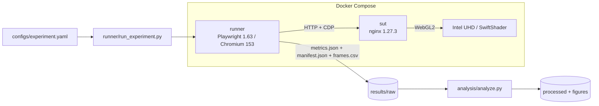
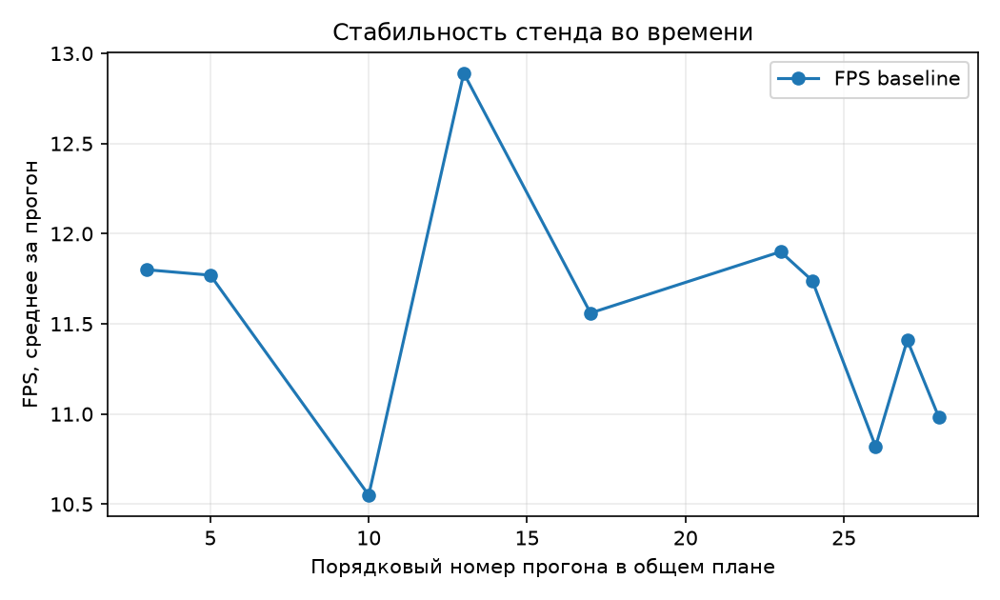
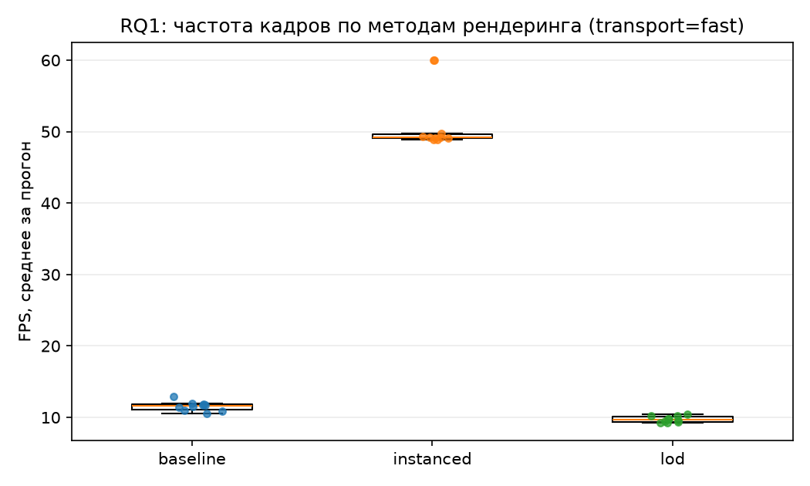
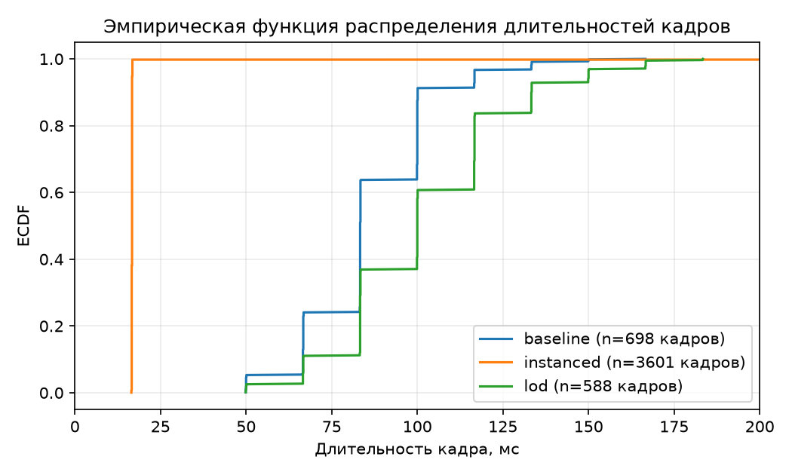
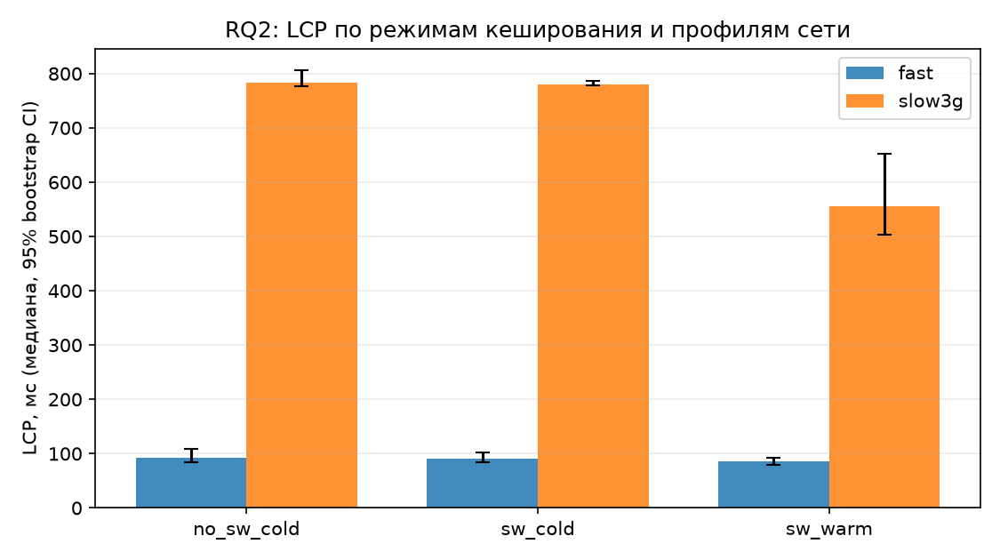
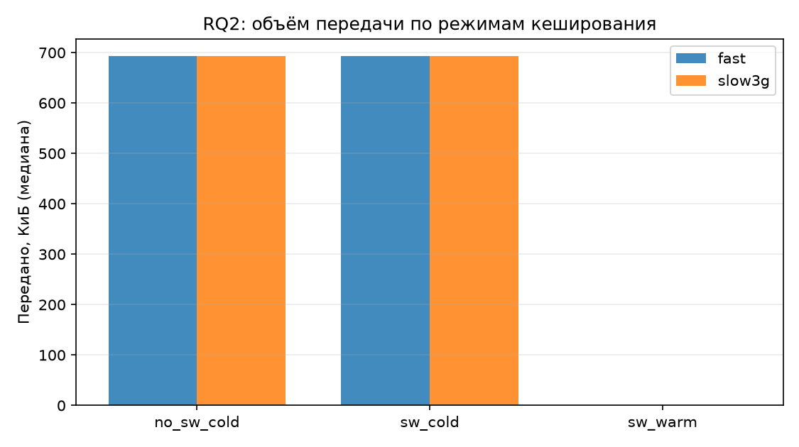
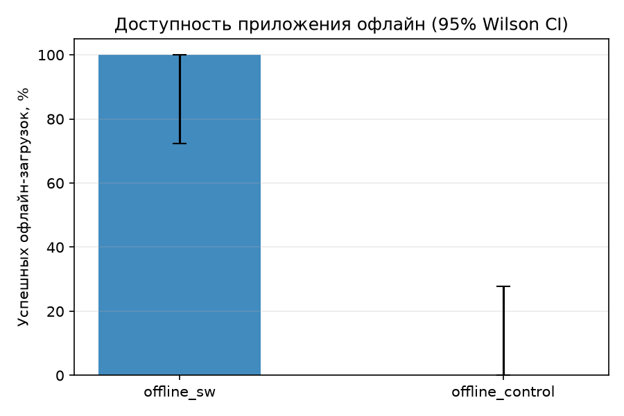

# Практическая работа № 4

## Реализация, тестирование и оценка экспериментального стенда

**Темы ВКР:**

1. «Исследование методов ускорения рендеринга WebGL графики для формирования рекомендаций для разработчиков».
2. «Исследование производительности и пользовательского опыта прогрессивных веб-приложений (PWA) в условиях ограниченного доступа к сети».

Стенд реализован как воспроизводимый артефакт `research-stand`: PWA с WebGL-сценой
(SUT), браузерный раннер на Playwright, оркестратор прогонов и скрипт статистического
анализа. Все результаты ниже получены этим стендом; сырые данные лежат в
`results/raw`, обработанные — в `results/processed`, графики — в `results/figures`.

---

## 1. Напоминание RQ и гипотез, изменения по сравнению с ПР3

**RQ1.** Даёт ли `InstancedMesh` и LOD статистически значимый прирост FPS при неизменной
сцене и графическом бэкенде?
H1₁: `instanced` быстрее `baseline`; H1₂: `lod` быстрее `baseline`.

**RQ2.** Сокращает ли service worker время загрузки и объём передачи при повторном визите
в сети 3G и какова цена первого визита?
H1₃: `sw_warm` быстрее `no_sw_cold` в `slow3g`; H1₄: `sw_cold` медленнее `no_sw_cold`.

**RQ3.** Доступно ли приложение офлайн только при активном service worker?
H1₅: доля успешных офлайн-загрузок при `sw` близка к 100 %, без `sw` — к 0 %.

**Изменения проекта стенда по сравнению с ПР3 и их причины.**

| Изменение | Причина |
|---|---|
| Число объектов сцены увеличено с 800 до 35 000 | при 800 объектах и на GPU все методы упирались в 60 FPS, эффект не измерялся (потолочный эффект) |
| Добавлен выбор графического бэкенда (`--use-angle=d3d11` / `swiftshader`) | на машине доступен аппаратный GPU; понадобился и контрольный прогон на программном растеризаторе |
| Анимация перенесена с объектов на камеру | уравнять вычислительную работу JS между `baseline` и `instanced` и изолировать вклад draw calls |
| Введена метрика `first_frame_ms` | LCP на canvas-приложении не отражает готовность сцены (см. раздел 7) |
| Результаты разложены по каталогам `raw`, `raw-repeat`, `raw-swiftshader` | отдельные кампании не должны смешиваться |
| Добавлена повторная кампания `configs/repeat.yaml` | проверка повторяемости на другом сиде |

Остальные решения ПР3 сохранены: дробный план A/B/C, 10 повторений, прогрев 2000 мс,
окно 6000 мс, рандомизация порядка, единица анализа — прогон.

---

## 2. Реализация стенда

### 2.1. Архитектура



### 2.2. Компоненты и версии

| Компонент | Технология и версия | Роль |
|---|---|---|
| SUT | nginx 1.27.3-alpine, three.js r170 | статическое PWA с WebGL2-сценой и service worker |
| Раннер | Python 3.12, Playwright 1.63.0, Chromium 153.0.8010.12 | управление сетью и CPU, сбор метрик, запись сырых файлов |
| Оркестратор | Python 3.14.2, PyYAML 6.0.2 | план, рандомизация, манифест кампании |
| Анализ | pandas 3.1.1, NumPy 2.5.5, SciPy 1.18.1, matplotlib 3.11.2 | статистика, тесты, графики |
| Контейнеры | `nginx:1.27.3-alpine`, `mcr.microsoft.com/playwright/python:v1.63.0-noble`, `python:3.12.10-slim` | фиксация окружения |
| CI | GitHub Actions, ubuntu-latest | автоматический прогон сокращённого плана |

Ограничения ресурсов в `docker-compose.yml`: SUT — `cpus: 2`, `memory: 1g`; раннер —
`cpus: 2`, `memory: 2g`. Лимиты не дают SUT и измерительному контуру конкурировать за все
ядра и делают конфигурацию ближе к реальному серверу.

### 2.3. Что именно делает SUT

- `scene.js` строит сцену из `objects` объектов, раскладывая их детерминированным
  генератором `mulberry32(seed)` в объёме 34 × 16 × 20; камера медленно обходит сцену по
  орбите, поэтому нагрузка на кадр стабильна.
- `baseline` — отдельный `Mesh` на объект (35 000 draw calls);
- `instanced` — один `InstancedMesh` (1 draw call) с теми же матрицами и цветами;
- `lod` — отдельные меши с переключением `IcosahedronGeometry(…, 2)` ↔ `(…, 0)` по
  расстоянию до камеры, проверка раз в 60 кадров и только при смене уровня;
- `none` — пустая сцена для калибровки.
- `sw.js` при установке precache-ит оболочку (HTML, CSS, четыре JS-модуля, three.js,
  манифест, иконку) и отвечает cache-first с fallback на `index.html`.
- `main.js` публикует `window.__bench` с методами `measure(warmup, window)`, `info()`,
  `startInteraction()`, `waitForServiceWorker()`.

### 2.4. Что именно делает раннер

1. Создаёт новый browser context (кеш и service worker не переносятся между прогонами).
2. Включает CDP-эмуляцию сети и, для `slow3g`, замедление CPU в 4 раза.
3. Выполняет сценарий режима: холодный визит, установка SW, повторный визит или офлайн.
4. Вызывает `__bench.measure(2000, 6000)`, затем измеряет прокси задержки взаимодействия.
5. Снимает `Performance.getMetrics` до и после окна и вычисляет `main_thread_busy_pct`.
6. Пишет три файла: `<run>.metrics.json`, `<run>.manifest.json`, `<run>.frames.csv`.

Манифест содержит параметры, сид, версию браузера, аргументы запуска, GPU, ОС, число CPU,
время старта и окончания, хеш конфигурации и коммит.

**Особенность выполнения.** На машине, где проводилась кампания, не был установлен Docker,
поэтому прогоны выполнены в локальном режиме (`--mode local`): тот же раннер, тот же
Chromium и те же аргументы, но без контейнера. Контейнерная конфигурация входит в артефакт
и запускается командами `make up`, `make smoke`, `make experiment`, `make analyze`. Это
ограничение зафиксировано в разделе 7; на результаты оно влияет только через отсутствие
лимитов `cpus`/`memory` у SUT.

---

## 3. Инструкция воспроизведения

Полная версия — в `README.md`. Кратко:

```bash
# Docker-путь
make up
make smoke
make experiment        # 110 прогонов основного плана
make analyze
make down

# Windows
.\run.ps1 up
.\run.ps1 smoke
.\run.ps1 experiment
.\run.ps1 analyze

# локальный путь без Docker
python -m pip install -r runner/requirements.txt
python -m playwright install chromium
python runner/run_experiment.py --mode local --port 8080
python analysis/analyze.py --raw results/raw --tag main
```

Дополнительные кампании:

```bash
python runner/run_experiment.py --mode local --config configs/calibration.yaml --force
python runner/run_experiment.py --mode local --config configs/repeat.yaml
python runner/run_experiment.py --mode local --config configs/experiment-swiftshader.yaml
python analysis/analyze.py --raw results/raw-repeat --tag repeat
python analysis/analyze.py --raw results/raw-swiftshader --tag swiftshader
```

Ожидаемый результат: `results/processed/main/tests.csv` с p-value и размерами эффекта,
`aa.json` с A/A-тестом, шесть PNG-графиков. Полный план на этой машине занял около 25 минут,
повторная кампания (45 прогонов) — около 12 минут, калибровка — около 1 минуты,
контроль на SwiftShader (25 прогонов) — около 8 минут.

---

## 4. Тестирование стенда

### 4.1. Smoke-тест

`python scripts/smoke.py --base-url http://127.0.0.1:8080` проверяет HTTP 200 для `/`,
`manifest.webmanifest`, `sw.js`, `main.js`, `scene.js`, `three.module.min.js`, создание
WebGL-контекста, непустые кадры и FPS. Результат: `SMOKE OK`.

### 4.2. A/A-тест

10 прогонов конфигурации `A / baseline / fast / no_sw_cold` случайно разделены на две
группы по 5 (сид разбиения 42):

| Метрика | Группа A | Группа B | Различие | p-value | δ Клиффа | CV прогонов | MDE |
|---|---|---|---|---|---|---|---|
| `fps_mean` | 11,56 | 11,77 | −1,8 % | 0,841 | −0,12 (negligible) | 5,73 % | 16,1 % |
| `frame_p95_ms` | 116,7 | 116,7 | 0 % | 0,824 | −0,12 | 9,51 % | 26,6 % |
| `lcp_ms` | 88,0 | 88,0 | 0 % | 1,000 | 0,04 | 6,36 % | 17,8 % |

Вывод: стенд не даёт систематического сдвига между группами. Шум стенда — около 6 % по FPS,
минимальный обнаруживаемый эффект — около 16 %. Это и есть нижняя граница практической
значимости, использованная в ПР3 (порог 20 %).

Отдельно: A/A на SwiftShader недоступен, потому что там всего 5 повторений на
конфигурацию; это ещё одна причина, по которой основной кампанией выбрана аппаратная
платформа.

### 4.3. Узкое место измерительного контура

Калибровочный блок K (`render = none`, пустая сцена, 5 прогонов):

| Метрика | Медиана | 95 % CI |
|---|---|---|
| `fps_mean` | 60,00 | 60,00–60,00 |
| `frame_p95_ms` | 16,70 | 16,70–16,80 |
| `main_thread_busy_pct` | 5,01 | 4,46–5,29 |

Пустая сцена держит потолок 60 FPS при занятости main thread около 5 %. Значит,
измерительный контур (Playwright, `requestAnimationFrame`, сбор метрик) не является узким
местом.

В основных прогонах занятость main thread распределяется так: `baseline` — 99,34 %,
`lod` — 99,37 %, `instanced` — 21,51 %. Это не ошибка стенда, а измеренная стоимость
отправки 35 000 draw calls из JavaScript: именно она и является предметом RQ1. Для
`instanced` запас по CPU сохраняется, поэтому ускорение достигается не за счёт
измерительного контура.

### 4.4. Стабильность во времени

Проверена ранговая корреляция метрики с временем запуска (33 проверки по трём метрикам).
Значимые тренды обнаружены в 4 случаях:

| Конфигурация | Метрика | ρ Спирмена | p |
|---|---|---|---|
| B / baseline / slow3g / no_sw_cold | `fps_mean` | −0,894 | 0,0005 |
| B / baseline / slow3g / no_sw_cold | `frame_p95_ms` | 0,691 | 0,027 |
| B / baseline / slow3g / sw_warm | `frame_p95_ms` | 0,669 | 0,034 |
| A / lod / fast / no_sw_cold | `lcp_ms` | 0,794 | 0,006 |

Тренд объясняется нагревом и фоновой нагрузкой при длинной кампании. Поскольку порядок
прогонов рандомизирован, дрейф увеличивает разброс, но не смещает сравнение групп
систематически. Это подтверждает решение из ПР3 о рандомизации и показывает, почему
последовательный прогон «сначала все A, потом все B» дал бы ложный эффект.



---

## 5. Результаты эксперимента

Основная кампания: 110 прогонов плана плюс 5 калибровочных, всего 115 записей; 105 валидных.
Невалидными ожидаемо оказались 10 прогонов негативного контроля `offline_control`
(навигация без сети и без service worker не может завершиться).

### 5.1. RQ1: методы рендеринга

| Метод | n | FPS, медиана [95 % CI] | `frame_p95_ms`, медиана | `jank_pct` | Draw calls | Main thread busy |
|---|---|---|---|---|---|---|
| `baseline` | 10 | 11,65 [10,98; 11,84] | 116,7 | 100 % | 35 000 | 99,34 % |
| `instanced` | 10 | 49,21 [49,05; 54,66] | 16,7 | 0,28 % | 1 | 21,51 % |
| `lod` | 10 | 9,68 [9,37; 10,17] | 149,95 | 100 % | 35 000 | 99,37 % |

Попарные сравнения (тест Манна–Уитни, поправка Холма, δ Клиффа):

| Сравнение | Δ медиан FPS | 95 % CI отношения | p (Holm) | δ | Эффект |
|---|---|---|---|---|---|
| `instanced` vs `baseline` | +322,4 % | 4,16–4,66 | 0,00036 | 1,00 | большой |
| `lod` vs `baseline` | −16,9 % | 0,80–0,89 | 0,00036 | −1,00 | большой |

`instanced` снижает p95 кадра со 116,7 до 16,7 мс (−85,7 %, CI отношения 0,134–0,154) и
долю «тяжёлых» кадров со 100 % до 0,28 %.

**H1₁ подтверждена:** переход на `InstancedMesh` даёт кратный рост FPS и устраняет
провалы кадров. **H1₂ опровергнута:** LOD не только не ускорил сцену, но и замедлил её на
17 %. Причина видна в данных: LOD сокращает число треугольников с 6,3 до 1,6 млн, но
оставляет 35 000 draw calls. Узкое место — не геометрия, а стоимость отправки вызовов и
переключения геометрии; вдобавок смена `geometry` у 35 000 мешей даёт всплески кадров
(p95 149,95 мс). Это тот случай, когда заранее сформулированная фальсифицируемая гипотеза
была отклонена данными.





### 5.2. RQ2: service worker и профиль сети

Профиль `slow3g`, `render = baseline`:

| Режим | n | `lcp_ms` | `load_ms` | `first_frame_ms` | `transfer_bytes` |
|---|---|---|---|---|---|
| `no_sw_cold` | 10 | 784 [776; 806] | 5641,75 [5625; 5731] | 4990,35 [4969; 5031] | 709 350 |
| `sw_cold` | 10 | 780 [778; 786] | 5723,80 [5685; 5801] | 5003,70 [4979; 5072] | 709 350 |
| `sw_warm` | 10 | 556 [502; 652] | 1199,15 [1084; 1289] | 635,25 [571; 723] | 0 |

Сравнения:

| Метрика | `sw_warm` vs `no_sw_cold` | 95 % CI отношения | p (Holm) | δ |
|---|---|---|---|---|
| `load_ms` | −78,7 % | 0,192–0,228 | 0,00055 | −1,00 |
| `first_frame_ms` | −87,3 % | 0,114–0,145 | 0,00055 | −1,00 |
| `lcp_ms` | −29,1 % | 0,640–0,836 | 0,00045 | −1,00 |
| `ttfb_ms` | −51,7 % | 0,406–0,565 | 0,00414 | −0,85 |
| `transfer_bytes` | −100 % | — | 0,00005 | −1,00 |

Первый визит с service worker (`sw_cold`) практически не отличается от визита без него:
`load_ms` +1,45 % (CI 1,001–1,029), p = 0,054; `lcp_ms` −0,5 % (p = 0,51);
`first_frame_ms` +0,27 % (p = 0,27). Гипотеза H1₄ о заметной цене первого визита **не
подтверждена**: precache выполняется после события `load` и в пределах нашего окна не
успевает заметно повлиять на загрузку. Это содержательный результат: цена переносится на
сетевой трафик и работу в фоне, а не на критические метрики первого экрана.

Профиль `fast` показывает тот же знак, но слабее: `load_ms` −7,8 % (p = 0,090),
`lcp_ms` −6,5 % (p = 0,47), `ttfb_ms` −44 % (p = 0,00084), `transfer_bytes` −100 %.
Это ожидаемо: при быстром канале кеш экономит меньше абсолютного времени.





### 5.3. RQ3: офлайн-доступность

| Режим | Прогонов | Успешных офлайн-загрузок | Доля | 95 % Wilson CI |
|---|---|---|---|---|
| `offline_sw` | 10 | 10 | 100 % | 0,72–1,00 |
| `offline_control` | 10 | 0 | 0 % | 0,00–0,28 |

**H1₅ подтверждена:** без service worker приложение офлайн не открывается ни разу, с
активным service worker — открывается во всех прогонах, причём `transfer_bytes = 0`,
`lcp_ms = 96`, `load_ms = 194` (медианы), то есть приложение обслуживается полностью из
кеша.



### 5.4. Повторная кампания (другой сид, n = 5)

| Проверка | Основная кампания | Повторная кампания | Совпадение |
|---|---|---|---|
| `instanced` vs `baseline`, FPS | +322 % | +682 % (49,12 vs 6,28) | направление и знак |
| `lod` vs `baseline`, FPS | −16,9 % | −12,6 % (5,49 vs 6,28) | направление и знак |
| `sw_warm` vs `no_sw_cold` в `slow3g`, `load_ms` | −78,7 % | −46,6 % | направление |
| `sw_warm` vs `no_sw_cold`, `first_frame_ms` | −87,3 % | −63,3 % | направление |
| `sw_warm` vs `no_sw_cold`, `transfer_bytes` | −100 % | −100 % | полное |
| `sw_warm` vs `no_sw_cold`, `lcp_ms` | −29,1 % | **+125,7 %** | расхождение |

Вывод о повторяемости: направление эффектов для FPS, `load_ms`, `first_frame_ms` и
`transfer_bytes` воспроизводится; LCP не воспроизводится даже по знаку. Причина — природа
LCP на canvas-приложении: кандидат в LCP выбирается по площади и моменту отрисовки
элементов интерфейса, а не по готовности сцены, поэтому при разной скорости ответа service
worker LCP может «переезжать» на другой элемент. Это ограничение конструктной валидности,
а не ошибка вычислений: `first_frame_ms` ведёт себя стабильно.

Абсолютные значения FPS между кампаниями различаются почти в 2 раза (11,65 и 6,28 для
`baseline`), что подтверждает: сравнивать можно только внутри одной кампании и одного
окружения.

### 5.5. Контрольный прогон на программном растеризаторе

`configs/experiment-swiftshader.yaml`, 4 000 объектов, 5 повторений:

| Метод | FPS, медиана [95 % CI] | CV | Main thread busy |
|---|---|---|---|
| `baseline` | 4,90 [4,84; 11,60] | 47,5 % | 98,75 % |
| `instanced` | 9,77 [8,88; 13,50] | 19,4 % | 43,89 % |
| `lod` | 5,49 [5,41; 14,33] | 49,1 % | 98,17 % |

Направление для `instanced` сохраняется (+99 %), но после поправки Холма различие уже не
значимо (p = 0,111) из-за n = 5 и высокой дисперсии. Эффект LOD меняет знак (+12 % против
−17 % на GPU). Практический вывод: программный растеризатор пригоден только для проверки
работоспособности стенда и грубого направления эффекта; количественные рекомендации по нему
строить нельзя.

---

## 6. Оценка результатов и сравнение со статьями

**RQ1.** Ускорение `instanced` в 4,2 раза по медиане FPS и сокращение времени кадра на
85,7 % согласуются по порядку с литературой: GL2GPU сообщает среднее сокращение времени
кадра 45,05 % [1], Usta — ускорение WebGPU в 2,5–3 раза [5], обзор методов в WebGL
называет instancing среди приоритетных приёмов [4]. Наш эффект больше, чем в [1], потому
что сцена специально доведена до 35 000 draw calls: при меньшем числе объектов (800) все
методы упирались в 60 FPS и эффект не наблюдался.

**RQ1, LOD.** Отрицательный результат не противоречит [4], но ограничивает область
применимости рекомендации: LOD сокращает геометрию, а не число вызовов. В [4] измерялись
время загрузки страницы и «общая эффективность», где вклад LOD мог быть связан с размером
ассетов, а не с FPS. Наш результат показывает, что при доминировании draw calls LOD без
батчинга бесполезен и даже вреден. Для рекомендаций разработчикам это означает:
LOD нужно применять вместе с instancing/батчингом, а не вместо него.

**RQ2.** Сокращение `load_ms` на 78,7 %, `first_frame_ms` на 87,3 % и трафика на 100 %
согласуются по направлению и порядку с [9], где FCP улучшился на 38–46 %, TTI — на
41–47 %, трафик — на 47–62 %. Наши значения выше, потому что SUT полностью локальный и
весь критический путь состоит из статических файлов, которые service worker отдаёт из
кеша; в [9] оптимизировались сторонние приложения с динамическим контентом. LCP у нас
сократился только на 29 %, что ближе к нижней границе литературы.

**RQ3.** Результат 10/10 против 0/10 подтверждает тезис [8] о service worker как основе
офлайн-доступности и даёт то, чего в [8] не хватает: воспроизводимую количественную
проверку с негативным контролем.

**Что не совпало.** Цена первого визита оказалась статистически незначимой, тогда как
обычно предполагается заметный штраф за установку service worker. Объяснение: precache
запускается после `load` и не блокирует критические метрики; на медленном канале штраф
проявился бы в фоновом трафике, который мы не измеряли отдельно. Это ограничение
измерительной схемы и направление для развития стенда.

---

## 7. Угрозы валидности и ограничения

| Угроза | Как проявилась | Влияние | Что делать |
|---|---|---|---|
| Тепловой и фоновый дрейф | 4 значимых тренда из 33; падение FPS в `slow3g` со временем (ρ = −0,89) | рост дисперсии, не смещение (порядок рандомизирован) | фиксировать схему питания, паузы между прогонами, парный дизайн A/B/A/B |
| Различие абсолютных значений между кампаниями | `baseline` 11,65 и 6,28 FPS | абсолютные числа не переносятся между сессиями | сравнивать только внутри кампании, сообщать CV |
| LCP не отражает готовность canvas | в повторе знак изменился на противоположный | выводы по LCP ненадёжны | основной метрикой считать `first_frame_ms`, LCP — вспомогательной |
| Программный растеризатор | эффект LOD меняет знак, CV до 49 % | количественные выводы на SwiftShader невозможны | использовать GPU-кампанию, SwiftShader — только как smoke/контроль |
| Отсутствие Docker на машине прогона | кампания выполнена локально | нет лимитов `cpus`/`memory` у SUT | прогнать контейнерный путь на машине с Docker и сравнить |
| Headless-браузер без дисплея | нет композитинга реального окна | отличается от пользовательского сценария | отдельный прогон в headed-режиме на референсной машине |
| Эмуляция 3G без потерь | задержка и полоса есть, потерь нет | оптимистичная оценка | добавить профили с потерями и джиттером |
| Множественные сравнения | 36 попарных сравнений | риск ложноположительных выводов | поправка Холма уже применена |
| n = 5 в контрольных кампаниях | эффект `instanced` на SwiftShader незначим | низкая мощность | увеличить n или не делать выводов |

**Ограничения стенда, выявленные в работе.**

1. Измерение браузерное, а не системное: `main_thread_busy_pct` показывает занятость
   main thread, но не загрузку GPU. Для сцен, ограниченных fill rate, нужна
   GPU-телиметрия (`EXT_disjoint_timer_query_webgl2`), которой в текущей версии нет.
2. Сцена синтетическая и однородная; реальные приложения имеют разные материалы,
   текстуры и прозрачность.
3. Офлайн-сценарий проверяет только доступность оболочки, но не синхронизацию данных.
4. LCP не подходит как основная UX-метрика для canvas-приложений.

---

## 8. Выводы и план развития стенда

**Выводы.**

1. Стенд реализован, контейнеризирован, запускается одной командой, сохраняет сырые
   данные и манифест каждого прогона; анализ выполняется скриптом.
2. Стенд проверен: smoke-тест пройден, A/A-тест не выявил сдвига (p = 0,84, δ = −0,12),
   калибровка на пустой сцене даёт 60 FPS при 5 % занятости main thread.
3. RQ1: instancing даёт кратный рост FPS (+322 %, p < 0,001), LOD при 35 000 draw calls
   вредит (−17 %); гипотеза H1₂ отклонена.
4. RQ2: service worker сокращает загрузку на 78,7 %, время до первого кадра — на 87,3 %,
   трафик — на 100 %; цена первого визита статистически незначима.
5. RQ3: офлайн-доступность обеспечивается только service worker (10/10 против 0/10).
6. Повторная кампания подтвердила направление эффектов для FPS и метрик загрузки, но не
   для LCP; это ограничение конструктной валидности LCP для canvas-приложений.

**План развития для финального эксперимента ВКР.**

1. Перевести основную метрику плавности на GPU-время кадра и добавить
   `EXT_disjoint_timer_query_webgl2` с явной пометкой `partial`, как это делают зрелые
   бенчмарки.
2. Сделать парный дизайн: чередовать конфигурации внутри одной сессии (A/B/A/B), чтобы
   дрейф сокращал разброс, а не только не смещал его.
3. Добавить фактор «комбинированный метод» (instancing + LOD) и свип по числу объектов
   (10k, 20k, 35k, 50k), чтобы найти порог, после которого draw calls становятся
   доминирующим узким местом.
4. Расширить сетевые профили: 3G с потерями 1–2 %, нестабильный канал, переключение
   online/offline в середине сессии.
5. Добавить проверку синхронизации данных офлайн (очередь операций, Background Sync) —
   это прямо относится ко второй теме ВКР.
6. Прогнать контейнерный путь на машине с Docker и GPU-пробросом, зафиксировать
   расхождение с локальным режимом.
7. Включить полный план в CI на сокращённой конфигурации и публиковать артефакты
   (уже заготовлено в `.github/workflows/experiment.yml`).

---

## Приложение. Артефакты и команды

| Артефакт | Путь |
|---|---|
| Сырые прогоны (115 файлов на прогон) | `results/raw` |
| Повторная кампания | `results/raw-repeat` |
| Контроль на SwiftShader | `results/raw-swiftshader` |
| Таблица «прогон × метрики» | `results/processed/main/runs.csv` |
| Описательные статистики | `results/processed/main/descriptives.csv` |
| Тесты и размеры эффекта | `results/processed/main/tests.csv` |
| A/A-тест | `results/processed/main/aa.json` |
| Дрейф | `results/processed/main/drift.csv` |
| Офлайн-доступность | `results/processed/main/offline.csv` |
| Сводка | `results/processed/main/summary.json` |
| Графики | `results/figures/main/*.png` |
| Конфигурация плана | `configs/experiment.yaml` |
| CI | `.github/workflows/experiment.yml` |

Команда полного воспроизведения:

```bash
make up && make smoke && make experiment && make analyze
```

Команда проверки на другой машине без Docker:

```bash
python runner/run_experiment.py --mode local --config configs/ci.yaml
python analysis/analyze.py --raw results/raw --tag ci
```
